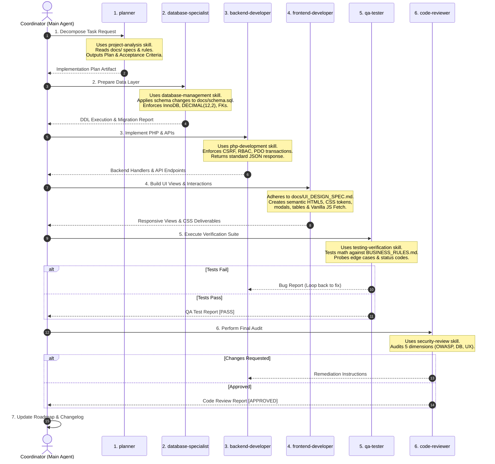

# Feature Implementation Workflow (`/implement-feature`)

## 1. Overview & Purpose
This workflow automates the repeatable end-to-end software development lifecycle for any feature or milestone in the **Small Business Sales and Expense Tracking System**. It coordinates the 6 specialized subagents to guarantee that every change is planned, database-verified, securely coded on the backend, beautifully designed on the frontend, tested, and audited before completion.

---

## 2. Orchestration Pipeline

---

## 3. Step-by-Step Execution Protocol

### Step 1: Planning & Architecture Analysis
- **Assigned Agent**: `planner`
- **Skill**: `project-analysis`
- **Actions**:
  1. Inspect current state in `docs/DEVELOPMENT_ROADMAP.md`.
  2. Cross-reference `docs/PROJECT_REQUIREMENTS.md`, `docs/DATABASE_SCHEMA.md`, and `docs/BUSINESS_RULES.md`.
  3. Output a structured plan with clear acceptance criteria and subagent task assignments.

### Step 2: Database Preparation & Migrations
- **Assigned Agent**: `database-specialist`
- **Skill**: `database-management`
- **Actions**:
  1. Write idempotent DDL in `docs/schema.sql` (`CREATE TABLE IF NOT EXISTS`).
  2. Verify `ENGINE=InnoDB`, `utf8mb4`, `DECIMAL(12,2)` for money, and `ON DELETE RESTRICT`.
  3. Execute migration and seed any required baseline data.

### Step 3: Backend Handler & UI Construction
- **Assigned Agent**: `backend-developer`
- **Skill**: `php-development`, `feature-implementation`
- **Actions**:
  1. Implement `handler.php` with session guard (`require_login()`), RBAC check (`require_permission(...)`), and anti-CSRF token verification.
  2. Implement business logic wrapped in PDO transactions (`beginTransaction`, `commit`, `rollBack`).
  3. Render UI in `index.php` using shared layout (`header.php`, `sidebar.php`, `footer.php`) and escape outputs.
  4. Ensure AJAX endpoints return `{ success, message, data, errors }`.

### Step 4: QA & Acceptance Verification
- **Assigned Agent**: `qa-tester`
- **Skill**: `testing-verification`
- **Actions**:
  1. Execute unit and integration tests in `tests/`.
  2. Verify calculation math against `docs/BUSINESS_RULES.md`.
  3. Test negative stock prevention and COD state transitions.
  4. Confirm all acceptance criteria from Step 1 are satisfied.

### Step 5: Security & Standards Code Review
- **Assigned Agent**: `code-reviewer`
- **Skill**: `security-review`
- **Actions**:
  1. Evaluate code across the 5 dimensions: Security (OWASP), Correctness, Architecture, Database discipline, and Cleanliness.
  2. Block completion if any security vulnerability or rule violation is detected.
  3. Issue final `APPROVED` verdict.

### Step 6: Progress & Documentation Finalization
- **Assigned Agent**: Coordinator (Main)
- **Actions**:
  1. Check off completed items in `docs/DEVELOPMENT_ROADMAP.md` (`[x]`).
  2. Record the addition in `CHANGELOG.md` under `[Unreleased]`.
