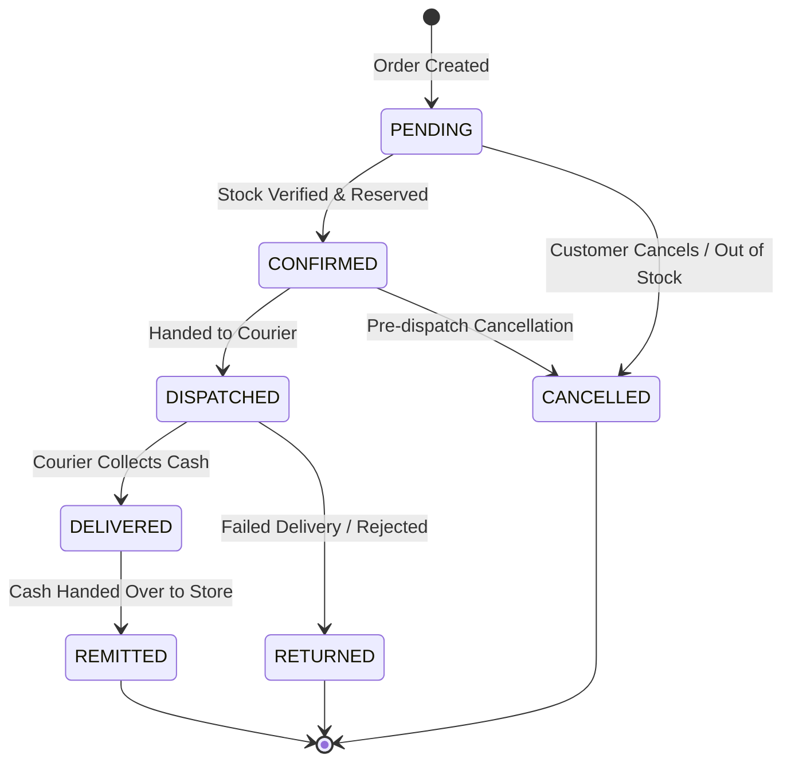

# Business Rules & Domain Logic

## 1. Purpose & Scope
This document specifies the core operational formulas, state transitions, stock handling rules, and validation logic for the **Small Business Sales and Expense Tracking System**. All agents and backend services must strictly enforce these domain rules.

---

## 2. Financial Calculation Rules

### 2.1. Sales & Revenue Math
- **Item Total**:
  $$\text{Line Total} = \text{unit\_price} \times \text{quantity}$$
- **Order Total**:
  $$\text{Total Amount} = \text{Subtotal} - \text{Discount Amount} + \text{Delivery Fee}$$
  *(Note: Per business requirements, tax calculations are excluded).*
- **Realized Revenue (Gross Sales)**:
  - Only orders with `order_status = 'DELIVERED'` and `payment_status IN ('COLLECTED', 'REMITTED')` count towards realized sales.
  - Orders with status `PENDING`, `CONFIRMED`, `DISPATCHED`, `CANCELLED`, or `RETURNED` are **excluded** from realized revenue.

### 2.2. Cost of Goods Sold (COGS) & Gross Profit
- **COGS**:
  $$\text{COGS} = \sum (\text{order\_items.unit\_cost} \times \text{order\_items.quantity}) \quad \text{for delivered orders}$$
- **Gross Profit**:
  $$\text{Gross Profit} = (\text{Realized Gross Sales} - \text{Delivery Fees}) - \text{COGS}$$

### 2.3. Net Income Formula
$$\text{Net Income} = \text{Realized Gross Sales} - \text{Total Operating Expenses}$$
- **Total Operating Expenses**: Sum of all expenses in `expenses` where `deleted_at IS NULL` within the selected date window.
- **Reporting Period Boundaries**:
  - Daily: `YYYY-MM-DD 00:00:00` to `YYYY-MM-DD 23:59:59`
  - Weekly: Monday `00:00:00` to Sunday `23:59:59`
  - Monthly: 1st of month `00:00:00` to last calendar day `23:59:59`

---

## 3. Order & COD Lifecycle State Machine

Orders must follow an explicit, directional lifecycle. Arbitrary state jumps are strictly prohibited.

### 3.1. Valid State Transitions & Actions
| Current State | Target State | Trigger / Prerequisite | Stock Effect |
| :--- | :--- | :--- | :--- |
| `PENDING` | `CONFIRMED` | Staff verifies details; checks stock availability. | Stock is **deducted** (`SALE`). |
| `PENDING` | `CANCELLED` | Customer cancels or invalid address. | No stock effect. |
| `CONFIRMED` | `DISPATCHED` | Courier picked up package for delivery. | No stock effect (already deducted). |
| `CONFIRMED` | `CANCELLED` | Order cancelled before shipment. | Stock is **restored** (`RETURN`). |
| `DISPATCHED` | `DELIVERED` | Courier marks as delivered & collected cash. | COD payment status becomes `COLLECTED`. |
| `DISPATCHED` | `RETURNED` | Customer unreachable / package refused. | Stock is **restored** upon physical check (`RESTOCK`). |
| `DELIVERED` | `REMITTED` | Cashier/Manager receives physical cash from courier. | COD payment status becomes `REMITTED`. |

### 3.2. COD Payment Invariants
- An order cannot have `payment_status = 'COLLECTED'` unless `order_status = 'DELIVERED'`.
- Realized sales reports only count cash once it reaches `COLLECTED` or `REMITTED`.
- Once an order is `REMITTED`, it cannot be voided without Manager or Admin approval and an explicit audit justification.

---

## 4. Inventory & Stock Rules

### 4.1. Atomicity & Reservation
1. **Deduction Moment**: Inventory stock is decremented at the moment an order transitions from `PENDING` $\rightarrow$ `CONFIRMED`.
2. **Negative Stock Prevention**: The system must check:
   $$\text{current\_stock} \ge \text{requested\_quantity}$$
   If any item in the order has insufficient stock, confirmation fails with an error: *"Insufficient stock for item [SKU]"*.
3. **Movement Logging**: Every stock change must create an entry in `inventory_movements` capturing `stock_before`, `stock_after`, and `movement_type`.

### 4.2. Low Stock Alert Trigger
- When `current_stock <= low_stock_threshold`, an automated `LOW_STOCK` entry is written to `notifications`.
- An item already flagged with an active unread notification must not trigger duplicate notification spam within the same 24-hour period.

---

## 5. Invoicing & Receipt Rules

### 5.1. Sequential Numbering
- **Invoices**: Formatted as `INV-YYYY-XXXX` (e.g., `INV-2026-0001`), where `XXXX` is a 4-digit sequential integer incremented per calendar year.
- **Receipts**: Formatted as `RCP-YYYY-XXXX` (e.g., `RCP-2026-0001`), generated when COD payment is confirmed as `COLLECTED`.

### 5.2. Document Immutability
- Invoices cannot be modified after being issued.
- If an order is cancelled after invoice issuance, the invoice status is marked as `VOID` with a void reason, never deleted.

---

## 6. Role-Based Permissions (RBAC) Matrix

| Business Operation | Admin | Manager | Cashier |
| :--- | :---: | :---: | :---: |
| Create Order / Sales Entry | Yes | Yes | Yes |
| Confirm / Dispatch Order | Yes | Yes | Yes |
| Mark COD Cash Remitted | Yes | Yes | No |
| Cancel Order (Pre-dispatch) | Yes | Yes | Yes |
| Void Order (Post-delivery) | Yes | No | No |
| Record Operating Expense | Yes | Yes | No |
| Edit / Soft Delete Expense | Yes | No | No |
| Stock Adjustment (Restock/Damage) | Yes | Yes | No |
| View Financial Reports (Net Income) | Yes | Yes (Store Summary) | No |
| Export Data (CSV / PDF) | Yes | Yes | No |
| Manage Staff Users & Roles | Yes | No | No |
| View Full System Audit Logs | Yes | Read Only | No |
