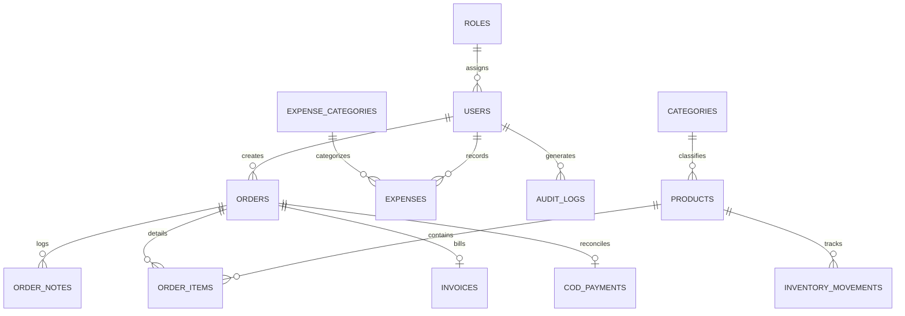

# Database Schema Specification

## 1. Overview & Conventions
- **Database Engine**: MySQL 8.x / MariaDB (InnoDB Engine)
- **Character Set & Collation**: `utf8mb4` / `utf8mb4_unicode_ci`
- **Monetary Precision**: All monetary values use `DECIMAL(12,2)` (no float/double).
- **Soft Deletes**: Key transactional tables implement `deleted_at TIMESTAMP NULL DEFAULT NULL`.
- **Foreign Keys**: Explicit foreign key constraints are enforced with `ON UPDATE CASCADE` and `ON DELETE RESTRICT` (to prevent accidental data loss).

---

## 2. Entity Relationship Diagram (Conceptual)

---

## 3. Table Definitions

### 3.1. Authentication & RBAC

#### `roles`
Stores system permission roles (`admin`, `manager`, `cashier`).
| Column | Type | Constraints | Description |
| :--- | :--- | :--- | :--- |
| `id` | INT UNSIGNED | PK, AUTO_INCREMENT | Unique role identifier |
| `name` | VARCHAR(50) | NOT NULL, UNIQUE | Role slug: `admin`, `manager`, `cashier` |
| `label` | VARCHAR(100) | NOT NULL | Human-readable title |
| `description` | VARCHAR(255) | NULL | Role description |
| `created_at` | TIMESTAMP | DEFAULT CURRENT_TIMESTAMP | Creation timestamp |

#### `users`
System accounts for staff and owners.
| Column | Type | Constraints | Description |
| :--- | :--- | :--- | :--- |
| `id` | INT UNSIGNED | PK, AUTO_INCREMENT | User identifier |
| `role_id` | INT UNSIGNED | NOT NULL, FK -> `roles.id` | Assigned user role |
| `username` | VARCHAR(50) | NOT NULL, UNIQUE | Login handle |
| `full_name` | VARCHAR(100) | NOT NULL | Staff member's display name |
| `password_hash` | VARCHAR(255) | NOT NULL | Bcrypt hashed credential |
| `is_active` | TINYINT(1) | NOT NULL DEFAULT 1 | 1 = Active, 0 = Suspended |
| `failed_logins` | INT UNSIGNED | NOT NULL DEFAULT 0 | Failed login attempt counter |
| `locked_until` | TIMESTAMP | NULL | Brute-force lockout expiration |
| `last_login_at` | TIMESTAMP | NULL | Timestamp of last access |
| `created_at` | TIMESTAMP | DEFAULT CURRENT_TIMESTAMP | Account creation date |
| `updated_at` | TIMESTAMP | DEFAULT CURRENT_TIMESTAMP ON UPDATE CURRENT_TIMESTAMP | Last modification |

---

### 3.2. Product & Inventory Management

#### `categories`
Product categorization.
| Column | Type | Constraints | Description |
| :--- | :--- | :--- | :--- |
| `id` | INT UNSIGNED | PK, AUTO_INCREMENT | Category identifier |
| `name` | VARCHAR(100) | NOT NULL, UNIQUE | Category name |
| `description` | TEXT | NULL | Optional description |
| `created_at` | TIMESTAMP | DEFAULT CURRENT_TIMESTAMP | Created timestamp |

#### `products`
Item catalog and current stock levels.
| Column | Type | Constraints | Description |
| :--- | :--- | :--- | :--- |
| `id` | INT UNSIGNED | PK, AUTO_INCREMENT | Product identifier |
| `category_id` | INT UNSIGNED | NOT NULL, FK -> `categories.id` | Product category |
| `sku` | VARCHAR(64) | NOT NULL, UNIQUE | Stock Keeping Unit code |
| `name` | VARCHAR(150) | NOT NULL | Product name |
| `cost_price` | DECIMAL(12,2) | NOT NULL DEFAULT 0.00 | Purchase/unit cost |
| `selling_price`| DECIMAL(12,2) | NOT NULL DEFAULT 0.00 | Retail price charged to customer |
| `current_stock`| INT | NOT NULL DEFAULT 0 | Physical quantity on hand |
| `low_stock_threshold`| INT | NOT NULL DEFAULT 5 | Minimum trigger for alerts |
| `status` | ENUM('active','inactive') | DEFAULT 'active' | Catalog display status |
| `created_at` | TIMESTAMP | DEFAULT CURRENT_TIMESTAMP | Creation timestamp |
| `updated_at` | TIMESTAMP | DEFAULT CURRENT_TIMESTAMP ON UPDATE CURRENT_TIMESTAMP | Last modification |

#### `inventory_movements`
Immutable audit log of all stock changes.
| Column | Type | Constraints | Description |
| :--- | :--- | :--- | :--- |
| `id` | BIGINT UNSIGNED | PK, AUTO_INCREMENT | Movement identifier |
| `product_id` | INT UNSIGNED | NOT NULL, FK -> `products.id` | Target product |
| `user_id` | INT UNSIGNED | NOT NULL, FK -> `users.id` | Who authorized the adjustment |
| `movement_type`| ENUM('INITIAL','RESTOCK','SALE','RETURN','DAMAGE','ADJUSTMENT') | NOT NULL | Type of stock shift |
| `quantity` | INT | NOT NULL | Positive (increase) or Negative (decrease) |
| `stock_before` | INT | NOT NULL | Stock count before mutation |
| `stock_after` | INT | NOT NULL | Stock count after mutation |
| `reference_type`| VARCHAR(50) | NULL | e.g., 'ORDER', 'MANUAL_ADJUST' |
| `reference_id` | BIGINT UNSIGNED | NULL | Linked ID (e.g., `orders.id`) |
| `notes` | VARCHAR(255) | NULL | Justification note |
| `created_at` | TIMESTAMP | DEFAULT CURRENT_TIMESTAMP | Movement timestamp |

---

### 3.3. Orders, COD Tracking & Invoicing

#### `orders`
Master order and COD tracking record.
| Column | Type | Constraints | Description |
| :--- | :--- | :--- | :--- |
| `id` | BIGINT UNSIGNED | PK, AUTO_INCREMENT | Master order identifier |
| `order_number` | VARCHAR(32) | NOT NULL, UNIQUE | Format: `ORD-YYYYMMDD-XXXX` |
| `user_id` | INT UNSIGNED | NOT NULL, FK -> `users.id` | Cashier/staff who entered order |
| `customer_name`| VARCHAR(100) | NOT NULL | Recipient name |
| `customer_phone`| VARCHAR(30) | NOT NULL | Contact number for delivery |
| `delivery_address`| TEXT | NOT NULL | Full delivery destination |
| `delivery_notes`| TEXT | NULL | Special delivery instructions |
| `subtotal` | DECIMAL(12,2) | NOT NULL DEFAULT 0.00 | Total item charges |
| `discount_amount`| DECIMAL(12,2) | NOT NULL DEFAULT 0.00 | Promotional deduction |
| `delivery_fee` | DECIMAL(12,2) | NOT NULL DEFAULT 0.00 | Shipping/courier fee |
| `total_amount` | DECIMAL(12,2) | NOT NULL DEFAULT 0.00 | `subtotal - discount + delivery_fee` |
| `order_status` | ENUM('PENDING','CONFIRMED','DISPATCHED','DELIVERED','CANCELLED','RETURNED') | DEFAULT 'PENDING' | Delivery progress |
| `payment_method`| VARCHAR(20) | NOT NULL DEFAULT 'COD' | Strictly `COD` |
| `payment_status`| ENUM('PENDING_COLLECTION','COLLECTED','REMITTED','FAILED') | DEFAULT 'PENDING_COLLECTION' | Cash status |
| `dispatched_at`| TIMESTAMP | NULL | Time dispatched for delivery |
| `delivered_at` | TIMESTAMP | NULL | Time delivered to customer |
| `cancelled_at` | TIMESTAMP | NULL | Time cancelled |
| `cancellation_reason` | VARCHAR(255) | NULL | Reason for void or cancellation |
| `deleted_at` | TIMESTAMP | NULL | Soft delete marker |
| `created_at` | TIMESTAMP | DEFAULT CURRENT_TIMESTAMP | Order creation timestamp |
| `updated_at` | TIMESTAMP | DEFAULT CURRENT_TIMESTAMP ON UPDATE CURRENT_TIMESTAMP | Last modification |

#### `order_items`
Individual line items inside an order.
| Column | Type | Constraints | Description |
| :--- | :--- | :--- | :--- |
| `id` | BIGINT UNSIGNED | PK, AUTO_INCREMENT | Line item ID |
| `order_id` | BIGINT UNSIGNED | NOT NULL, FK -> `orders.id` | Associated order |
| `product_id` | INT UNSIGNED | NOT NULL, FK -> `products.id` | Sold product |
| `product_name`| VARCHAR(150) | NOT NULL | Snapshot of name at time of sale |
| `unit_cost` | DECIMAL(12,2) | NOT NULL | Snapshot of cost price |
| `unit_price` | DECIMAL(12,2) | NOT NULL | Selling price charged |
| `quantity` | INT | NOT NULL | Quantity sold |
| `line_total` | DECIMAL(12,2) | NOT NULL | `unit_price * quantity` |
| `created_at` | TIMESTAMP | DEFAULT CURRENT_TIMESTAMP | Creation timestamp |

#### `cod_payments`
Cash on Delivery collection and cash reconciliation log.
| Column | Type | Constraints | Description |
| :--- | :--- | :--- | :--- |
| `id` | BIGINT UNSIGNED | PK, AUTO_INCREMENT | Payment transaction identifier |
| `order_id` | BIGINT UNSIGNED | NOT NULL, UNIQUE, FK -> `orders.id` | Associated COD order |
| `amount_due` | DECIMAL(12,2) | NOT NULL | Expected cash collection |
| `amount_collected`| DECIMAL(12,2) | NOT NULL DEFAULT 0.00 | Actual cash received from buyer |
| `collected_by` | VARCHAR(100) | NULL | Courier / delivery staff name |
| `collected_at` | TIMESTAMP | NULL | Delivery completion time |
| `remitted_to_user_id`| INT UNSIGNED | NULL, FK -> `users.id` | Store cashier/manager who received cash |
| `remitted_at` | TIMESTAMP | NULL | Reconciliation timestamp |
| `status` | ENUM('PENDING','COLLECTED','REMITTED','FAILED') | DEFAULT 'PENDING' | Status of cash handover |
| `notes` | VARCHAR(255) | NULL | Reconciliation notes or discrepancies |
| `created_at` | TIMESTAMP | DEFAULT CURRENT_TIMESTAMP | Created timestamp |

#### `invoices`
Formal invoice and receipt records.
| Column | Type | Constraints | Description |
| :--- | :--- | :--- | :--- |
| `id` | BIGINT UNSIGNED | PK, AUTO_INCREMENT | Invoice identifier |
| `order_id` | BIGINT UNSIGNED | NOT NULL, UNIQUE, FK -> `orders.id` | Associated order |
| `invoice_number`| VARCHAR(32) | NOT NULL, UNIQUE | Serial: `INV-YYYY-XXXX` |
| `receipt_number`| VARCHAR(32) | NOT NULL, UNIQUE | Serial: `RCP-YYYY-XXXX` |
| `issued_date` | DATE | NOT NULL | Issuing date |
| `amount_paid` | DECIMAL(12,2) | NOT NULL DEFAULT 0.00 | Amount settled |
| `status` | ENUM('ISSUED','PAID','VOID') | DEFAULT 'ISSUED' | Document status |
| `void_reason` | VARCHAR(255) | NULL | Justification for voiding document |
| `pdf_path` | VARCHAR(255) | NULL | Stored PDF location if generated |
| `created_at` | TIMESTAMP | DEFAULT CURRENT_TIMESTAMP | Creation timestamp |
| `updated_at` | TIMESTAMP | DEFAULT CURRENT_TIMESTAMP ON UPDATE CURRENT_TIMESTAMP | Last modification |

---

### 3.4. Expenses Management

#### `expense_categories`
Classification for operating costs.
| Column | Type | Constraints | Description |
| :--- | :--- | :--- | :--- |
| `id` | INT UNSIGNED | PK, AUTO_INCREMENT | Category identifier |
| `name` | VARCHAR(100) | NOT NULL, UNIQUE | Category name (e.g., Rent, Utilities, Packaging) |
| `description` | VARCHAR(255) | NULL | Category description |
| `created_at` | TIMESTAMP | DEFAULT CURRENT_TIMESTAMP | Created timestamp |

#### `expenses`
Business expenditure log.
| Column | Type | Constraints | Description |
| :--- | :--- | :--- | :--- |
| `id` | BIGINT UNSIGNED | PK, AUTO_INCREMENT | Expense identifier |
| `category_id` | INT UNSIGNED | NOT NULL, FK -> `expense_categories.id`| Expense category |
| `user_id` | INT UNSIGNED | NOT NULL, FK -> `users.id` | Staff who recorded the expense |
| `title` | VARCHAR(150) | NOT NULL | Brief summary of expense |
| `amount` | DECIMAL(12,2) | NOT NULL | Expense value |
| `expense_date`| DATE | NOT NULL | Date incurred |
| `receipt_path`| VARCHAR(255) | NULL | Secure upload path of receipt image/PDF |
| `notes` | TEXT | NULL | Additional details |
| `deleted_at` | TIMESTAMP | NULL | Soft delete timestamp |
| `created_at` | TIMESTAMP | DEFAULT CURRENT_TIMESTAMP | Creation timestamp |
| `updated_at` | TIMESTAMP | DEFAULT CURRENT_TIMESTAMP ON UPDATE CURRENT_TIMESTAMP | Last modification |

---

### 3.5. Communication & Notifications

#### `order_notes`
Internal comments and customer timeline communication for orders.
| Column | Type | Constraints | Description |
| :--- | :--- | :--- | :--- |
| `id` | BIGINT UNSIGNED | PK, AUTO_INCREMENT | Note ID |
| `order_id` | BIGINT UNSIGNED | NOT NULL, FK -> `orders.id` | Target order |
| `user_id` | INT UNSIGNED | NOT NULL, FK -> `users.id` | Author staff member |
| `note` | TEXT | NOT NULL | Internal remark (e.g. delivery coordination) |
| `created_at` | TIMESTAMP | DEFAULT CURRENT_TIMESTAMP | Timestamp |

#### `notifications`
System alerts for low stock and pending COD remissions.
| Column | Type | Constraints | Description |
| :--- | :--- | :--- | :--- |
| `id` | BIGINT UNSIGNED | PK, AUTO_INCREMENT | Notification ID |
| `user_id` | INT UNSIGNED | NULL, FK -> `users.id` | Target user (NULL = all staff) |
| `type` | ENUM('LOW_STOCK','COD_PENDING','ORDER_DISPATCHED','SYSTEM') | NOT NULL | Alert category |
| `title` | VARCHAR(150) | NOT NULL | Alert subject |
| `message` | TEXT | NOT NULL | Detailed message |
| `is_read` | TINYINT(1) | NOT NULL DEFAULT 0 | 0 = Unread, 1 = Read |
| `reference_type`| VARCHAR(50) | NULL | e.g., 'PRODUCT', 'ORDER' |
| `reference_id` | BIGINT UNSIGNED | NULL | Referenced record ID |
| `created_at` | TIMESTAMP | DEFAULT CURRENT_TIMESTAMP | Created timestamp |

---

### 3.6. Audit Trails

#### `audit_logs`
Immutable compliance and activity record.
| Column | Type | Constraints | Description |
| :--- | :--- | :--- | :--- |
| `id` | BIGINT UNSIGNED | PK, AUTO_INCREMENT | Log ID |
| `user_id` | INT UNSIGNED | NULL, FK -> `users.id` | Action actor (NULL for system/cron) |
| `module` | VARCHAR(50) | NOT NULL | Domain: `sales`, `expenses`, `inventory`, `auth` |
| `action` | VARCHAR(50) | NOT NULL | Operation: `CREATE`, `UPDATE`, `SOFT_DELETE`, `LOGIN`, `EXPORT` |
| `record_id` | BIGINT UNSIGNED | NULL | Impacted primary key |
| `old_values` | JSON | NULL | State before mutation |
| `new_values` | JSON | NULL | State after mutation |
| `ip_address` | VARCHAR(45) | NOT NULL | Client IPv4 / IPv6 |
| `user_agent` | VARCHAR(255) | NULL | Browser / device string |
| `created_at` | TIMESTAMP | DEFAULT CURRENT_TIMESTAMP | Event timestamp |
