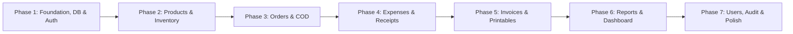

# Development Roadmap & Implementation Plan

## 1. Overview & Strategy
This roadmap outlines the phased implementation of the **Small Business Sales and Expense Tracking System**. Development follows an **incremental, verifiable slice** approach: each phase produces working, testable functionality. 

At the end of every phase, explicit **"Steps for Local Verification"** are provided so you can open your browser, test specific features, and verify the system in XAMPP before moving forward.

---

## 2. Phased Implementation Milestones

---

### Phase 1: Foundation, Database, UI Shell & Authentication
- [x] **1.1. Canonical SQL Migration**:
  - Create `docs/schema.sql` containing all DDL statements from `docs/DATABASE_SCHEMA.md` with initial seed roles (`admin`, `manager`, `cashier`), default admin user (`admin` / `admin123`), and default categories.
- [x] **1.2. Core Configuration & Database Connection**:
  - `config/constants.php`: App name, currency (`₱`), default statuses, timezone.
  - `config/database.php`: Robust PDO singleton connection with error handling and strict mode.
- [x] **1.3. Security & Utilities Layer**:
  - `includes/csrf.php`: Anti-CSRF token generator and validator.
  - `includes/auth.php`: Session lifecycle, brute-force tracking, timeout check.
  - `includes/rbac.php`: Role permission lookup and `check_permission()` guard.
  - `includes/audit.php`: Centralized activity logger helper.
- [x] **1.4. UI Design System & App Shell**:
  - Implement stylesheets from `docs/UI_DESIGN_SPEC.md`: `assets/css/main.css`, `components.css`.
  - Create reusable layout templates: `includes/header.php`, `includes/sidebar.php`, `includes/footer.php`.
  - Setup centralized Fetch wrapper with automatic CSRF injection: `assets/js/api.js`.
- [x] **1.5. Auth Module**:
  - `modules/auth/login.php`: Clean login form with CSRF and error alerts.
  - `modules/auth/handler.php`: Authenticates credentials with `password_verify()`, regenerates session ID, resets failed attempts.
  - `modules/auth/logout.php`: Safe session teardown.

#### 🔍 Steps for Local Verification (Phase 1):
1. **Import Database**: Open `http://localhost/phpmyadmin` and import `docs/schema.sql` into database `business_tracking_db`. Verify all 14 tables and initial seed data exist.
2. **Access Login**: Open `http://localhost/Business%20Tracking%20System/modules/auth/login.php`. Confirm the page displays cleanly with the design tokens.
3. **Test Invalid Login**: Enter wrong credentials (e.g. `admin` / `wrongpass`). Confirm a clean error message appears without exposing SQL errors or stack traces.
4. **Test Brute-Force Lockout**: Enter wrong credentials 5 consecutive times. Confirm the system locks out further attempts for 15 minutes.
5. **Test Successful Login**: Log in using `admin` / `admin123`. Confirm redirection to `modules/dashboard/index.php`.
6. **Verify App Shell Layout**:
   - Check desktop view: Dark sidebar on left, top navbar with user profile (`admin`), responsive main content area.
   - Resize browser window to mobile width ($< 1024\text{px}$): Confirm sidebar collapses into off-canvas drawer toggled by the hamburger (`☰`) button.
7. **Test Safe Logout**: Click Logout. Confirm session is destroyed, cookies expired, and user is returned to the login screen. Attempting to navigate back directly to the dashboard must redirect to login.

---

### Phase 2: Product Catalog & Inventory Management
- [x] **2.1. Product Categories**:
  - Category list and modal CRUD (`modules/products/categories.php`).
- [x] **2.2. Product Catalog**:
  - Product list table with SKU, name, category, cost price, selling price, current stock, and low stock threshold.
  - Add/Edit product modal with validation.
- [x] **2.3. Stock Adjustment & Movement Ledger**:
  - Restock and adjustment modal (`modules/inventory/index.php`).
  - Atomic logging to `inventory_movements` (stock before, stock after, movement type).
  - Low stock warning badges when `current_stock <= low_stock_threshold`.

#### 🔍 Steps for Local Verification (Phase 2):
1. **Open Products**: Navigate to `http://localhost/Business%20Tracking%20System/modules/products/`.
2. **Create Category**: Add a new category (e.g. "Electronics") and verify it appears in the dropdown.
3. **Create Product**: Add a new product (e.g. SKU: `PROD-001`, Selling: `₱500.00`, Cost: `₱350.00`, Stock: `10`, Low Stock Alert: `5`).
4. **Test Stock Adjustment**:
   - Navigate to Inventory $\rightarrow$ Restock. Add `+5` units.
   - Confirm stock increases to `15` and an immutable record appears in the Inventory Movement Ledger with type `RESTOCK`.
5. **Test Negative Stock Prevention**: Attempt to deduct `20` units when only `15` are available. Confirm the system rejects the adjustment with an error message: *"Insufficient stock"*.
6. **Verify Low Stock Alert**: Adjust stock down to `3` units (below threshold `5`). Confirm product badge turns red (`Low Stock`) and a notification alert appears in the top navbar.

---

### Phase 3: Sales, Orders & Cash on Delivery (COD) Workflow
- [x] **3.1. POS / Order Creation Interface**:
  - Split view: Product selector on left, COD cart and recipient details on right.
  - Subtotal, discount deduction, delivery fee, and COD Total calculation (no tax).
- [x] **3.2. COD Lifecycle State Machine**:
  - Transition order: `PENDING` $\rightarrow$ `CONFIRMED` (deducts stock) $\rightarrow$ `DISPATCHED` $\rightarrow$ `DELIVERED` (cash collected) $\rightarrow$ `REMITTED` (cash handed to store).
  - Pre-dispatch cancellation automatically restores stock with `RETURN` movement.
- [x] **3.3. Order Notes & Timeline**:
  - Customer and courier coordination comments.

#### 🔍 Steps for Local Verification (Phase 3):
1. **Open POS / Create Order**: Navigate to `http://localhost/Business%20Tracking%20System/modules/orders/create.php`.
2. **Build Cart & Calculate**:
   - Add 2 units of `PROD-001` (`₱500.00` each = `₱1,000.00`).
   - Enter Discount: `₱50.00`, Delivery Fee: `₱80.00`.
   - Confirm Total strictly calculates as `₱1,030.00` (`1000 - 50 + 80`, zero tax).
3. **Submit COD Order**: Enter Customer Name ("Juan Dela Cruz"), Phone ("09171234567"), Delivery Address, and click "Submit Order".
4. **Verify Stock Deduction on Confirmation**:
   - Confirm order status becomes `CONFIRMED`.
   - Inspect product stock: confirm `PROD-001` stock decreased by `2` units and movement ledger shows type `SALE`.
5. **Test Pre-Dispatch Cancellation**: Create another test order, confirm it, then click "Cancel Order". Confirm stock is automatically restored with type `RETURN`.
6. **Walk Through COD State Transitions**:
   - Dispatch order: Click "Mark as Dispatched" (handed to courier).
   - Deliver order: Click "Mark as Delivered" (courier collected cash). Confirm payment status shows `COLLECTED`.
   - Remit cash: Click "Remit Cash to Store". Confirm payment status becomes `REMITTED`.

---

### Phase 4: Expense Management & Receipt Uploads
- [x] **4.1. Expense Categories**:
  - Pre-seeded categories: Utilities, Rent, Logistics, Packaging, Office Supplies.
- [x] **4.2. Expense Entry Form**:
  - Date, category, amount, title, notes, and receipt upload.
- [x] **4.3. Secure Upload Handling**:
  - Server-side MIME verification (`finfo_file`), `.pdf`, `.jpg`, `.png` only, safe hashed filenames.
- [x] **4.4. Soft Delete with Audit**:
  - Soft-delete expense with mandatory justification note.

#### 🔍 Steps for Local Verification (Phase 4):
1. **Open Expenses**: Navigate to `http://localhost/Business%20Tracking%20System/modules/expenses/`.
2. **Add Expense with Receipt**:
   - Click "+ Record Expense".
   - Fill Title: "Packaging Tape & Bubble Wrap", Amount: `₱450.00`, Category: "Packaging Materials".
   - Attach a sample receipt image (`.png` or `.jpg`).
   - Click Save. Confirm expense is added and receipt thumbnail is viewable.
3. **Test Upload Security Check**: Attempt to upload a disallowed file (e.g. `.php`, `.exe`, or `.txt`). Confirm the server rejects the upload with an error.
4. **Test Soft Deletion**:
   - Click "Delete" on an expense.
   - Enter reason: "Duplicate entry".
   - Confirm the expense disappears from the active table.
   - Check database: confirm record still exists with `deleted_at IS NOT NULL`.

---

### Phase 5: Invoicing, Receipts & Printable Layouts
- [x] **5.1. Sequential Document Numbering**:
  - Auto-generated `INV-YYYY-XXXX` and `RCP-YYYY-XXXX`.
- [x] **5.2. Printable Layouts (`assets/css/print.css`)**:
  - 80mm thermal receipt layout for POS printers.
  - Standard A4 formal invoice layout.

#### 🔍 Steps for Local Verification (Phase 5):
1. **Open Invoices**: Navigate to `http://localhost/Business%20Tracking%20System/modules/invoices/`.
2. **View Invoice**: Click on any completed order invoice.
   - Confirm sequential number is formatted as `INV-2026-0001`.
   - Confirm customer name, delivery address, itemized rows, and COD balance due match.
3. **Test A4 Print Layout**:
   - Press `Ctrl + P` (Print Preview).
   - Confirm print preview shows a clean document: sidebar, navigation bars, and buttons are hidden.
4. **Test 80mm Thermal Receipt**:
   - Open receipt view (`RCP-2026-0001`).
   - Confirm layout is constrained to `80mm` width with monospace text suitable for POS thermal printers.

---

### Phase 6: Financial Reports & Dashboard KPIs
- [x] **6.1. Interactive Dashboard**:
  - Today's Gross Sales, Today's Expenses, Cash on Hand (Remitted), Low Stock count.
- [x] **6.2. Financial Performance Reports**:
  - Net Income calculation: $\text{Realized Gross Sales} - \text{Total Operating Expenses}$.
  - Daily, weekly, monthly, and custom date range filters.
- [x] **6.3. Low-Memory CSV Export**:
  - Stream data via `php://output`.

#### 🔍 Steps for Local Verification (Phase 6):
1. **Open Dashboard**: Navigate to `http://localhost/Business%20Tracking%20System/modules/dashboard/`.
   - Confirm KPI cards display accurate figures matching today's delivered orders and expenses.
2. **Open Financial Reports**: Navigate to `http://localhost/Business%20Tracking%20System/modules/reports/`.
3. **Verify Net Income Formula**:
   - Check Daily report: Confirm $\text{Net Income} = \text{Gross Sales (Delivered \& Collected)} - \text{Total Expenses}$.
   - Confirm uncollected, pending, or cancelled orders are **excluded** from sales.
4. **Test Date Filter**: Filter by "This Week" and "This Month". Confirm calculations adjust to the exact date boundaries.
5. **Test CSV Export**: Click "Export CSV". Open downloaded file in Excel/Notepad. Confirm columns, rows, and headers are formatted cleanly.

---

### Phase 7: Role-Based Access Control, Audit Logs & System Polish
- [x] **7.1. User Administration (Admin Only)**:
  - Create staff accounts, assign roles (`manager`, `cashier`), activate/deactivate accounts, reset passwords with lockout clearing.
- [x] **7.2. Audit Trail Viewer (Admin/Manager)**:
  - Searchable log of all logins, sales, expenses, and configuration changes with JSON diff inspection.
- [x] **7.3. RBAC Separation & Security Polish**:
  - Verify Cashier role permissions and restricted views, self-deactivation/self-demotion invariants.

#### 🔍 Steps for Local Verification (Phase 7):
1. **Create Staff Accounts (as Admin)**:
   - Go to User Management.
   - Create Manager: `manager1` / `manager123` (Role: Manager).
   - Create Cashier: `cashier1` / `cashier123` (Role: Cashier).
2. **Log in as Cashier (`cashier1`)**:
   - Confirm Cashier can access POS / Create Order and view basic product stock.
   - Confirm sensitive menus are **hidden**: Expenses, Financial Reports (Net Income), Users, and Audit Logs.
   - Attempt to manually type URL `http://localhost/Business%20Tracking%20System/modules/reports/`. Confirm server blocks access with a `403 Forbidden` page.
3. **Log in as Manager (`manager1`)**:
   - Confirm Manager can view sales, adjust stock, record expenses, and view summary reports.
   - Confirm User Management and Audit Log purging are inaccessible.
4. **Log in as Admin (`admin`)**:
   - Open Audit Logs (`modules/audit/`).
   - Confirm every login, order creation, stock adjustment, and expense edit has a timestamped record with user ID, IP address, and JSON diffs (`old_values`, `new_values`).
