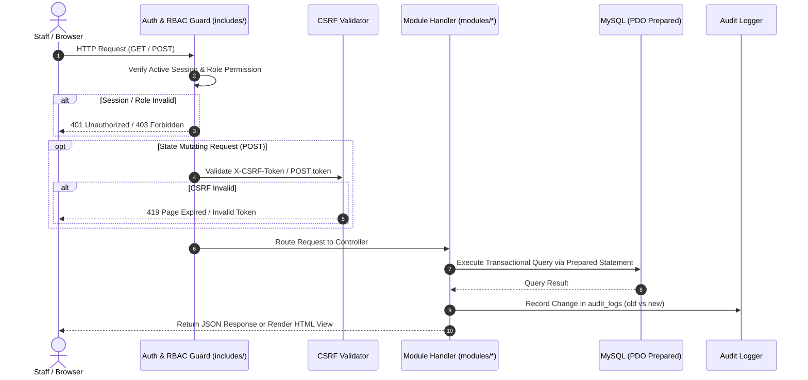

# System Architecture & Technical Design

## 1. Architectural Style & Principles
- **Pattern**: Modular Service-Oriented PHP (without heavy external frameworks).
- **Core Principles**:
  - **Separation of Concerns**: UI rendering is strictly separated from data mutations and business rules.
  - **Low Cognitive Overhead**: Clean procedural/object-oriented PHP suitable for local XAMPP/Apache hosting.
  - **Zero Direct SQL in Views**: Database queries live strictly in module handlers or service functions.
  - **Single Response Contract**: Every AJAX endpoint returns a standardized JSON structure.

---

## 2. Directory Layout & Module Structure

```text
Business Tracking System/
├── .agents/                      # Antigravity Agent Harness (rules, skills, workflows)
│   ├── rules/                    # Enforced behavioral invariants
│   └── skills/                   # Reusable runbooks and generators
├── assets/                       # Public Static Assets
│   ├── css/
│   │   ├── main.css              # Global styles, variables, typography, layout
│   │   ├── components.css        # Buttons, cards, modals, tables, badges
│   │   └── print.css             # Print-specific styles for 80mm receipts & A4 invoices
│   └── js/
│       ├── api.js                # Fetch wrapper with CSRF injection & error handling
│       ├── app.js                # App shell, sidebar toggle, notification polling
│       └── modules/              # Dedicated JS per business module
├── config/                       # System Configurations
│   ├── constants.php             # System constants, currency, tax rates (0), statuses
│   └── database.php              # PDO singleton connection pool with error handling
├── docs/                         # Knowledge Base & Architecture Records
│   ├── PROJECT_REQUIREMENTS.md
│   ├── DATABASE_SCHEMA.md
│   ├── BUSINESS_RULES.md
│   ├── SYSTEM_ARCHITECTURE.md
│   ├── DEVELOPMENT_ROADMAP.md
│   └── CHANGELOG.md
├── includes/                     # Shared System Utilities & Templates
│   ├── auth.php                  # Session check, login/logout, session expiry
│   ├── rbac.php                  # Role-based access control guards
│   ├── csrf.php                  # CSRF token generation and validation
│   ├── audit.php                 # Activity logging helper
│   ├── header.php                # Top navigation & shared layout header
│   ├── sidebar.php               # Role-aware sidebar menu
│   └── footer.php                # Shared layout footer & scripts
├── modules/                      # Self-Contained Business Domains
│   ├── auth/                     # Login, logout, credential management
│   ├── dashboard/                # KPIs, net income card, quick links
│   ├── products/                 # Catalog, pricing, categories
│   ├── inventory/                # Stock level management, movement ledger
│   ├── orders/                   # Order creation, COD lifecycle, delivery tracking
│   ├── expenses/                 # Expense recording, receipt uploads, categories
│   ├── invoices/                 # Invoice/receipt generation, printable views
│   ├── reports/                  # Daily, weekly, monthly financial summaries & exports
│   ├── notifications/            # Low stock & COD collection alerts
│   ├── audit/                    # System audit trail viewer
│   └── users/                    # User administration & role assignment
└── tests/                        # Automated Verification Suites
    ├── Unit/                     # Business logic and formula tests
    └── Integration/              # Database mutation and transaction tests
```

---

## 3. Request Lifecycle & Security Pipeline



---

## 4. Standard Response Formats

### 4.1. AJAX / API Response Contract
All endpoints handling asynchronous requests (Fetch API) must return this exact JSON schema:
```json
{
  "success": true,
  "message": "Order #ORD-20260311-0012 marked as DELIVERED.",
  "data": {
    "order_id": 12,
    "order_status": "DELIVERED",
    "payment_status": "COLLECTED"
  },
  "errors": []
}
```
For failures (`success: false`):
```json
{
  "success": false,
  "message": "Insufficient stock for product SKU-WIDGET-01.",
  "data": null,
  "errors": [
    "Requested quantity: 5, Available quantity: 2"
  ]
}
```

---

## 5. Frontend Architecture & Helpers

### 5.1. Centralized Fetch Wrapper (`assets/js/api.js`)
To avoid duplicating CSRF headers and error handling in every script:
- Automatically reads the CSRF token from `<meta name="csrf-token" content="...">`.
- Injects `X-Requested-With: XMLHttpRequest` and `X-CSRF-Token` headers into every `POST`/`PUT`/`DELETE`.
- Automatically catches HTTP errors, session timeouts, and displays standardized toast alerts.

### 5.2. Print & Receipt Styles (`assets/css/print.css`)
- Support `@media print` rules.
- Strips out sidebars, navigation headers, and background colors during printing.
- Dedicated thermal receipt template constrained to `80mm` width for POS printers.

---

## 6. Export Architecture
- **CSV Streaming**: To prevent memory spikes on large tables, exports stream rows directly using `php://output` and `fputcsv()`.
- **Headers Sent**:
  ```php
  header('Content-Type: text/csv; charset=utf-8');
  header('Content-Disposition: attachment; filename="sales_report_' . date('Y-m-d') . '.csv"');
  ```
